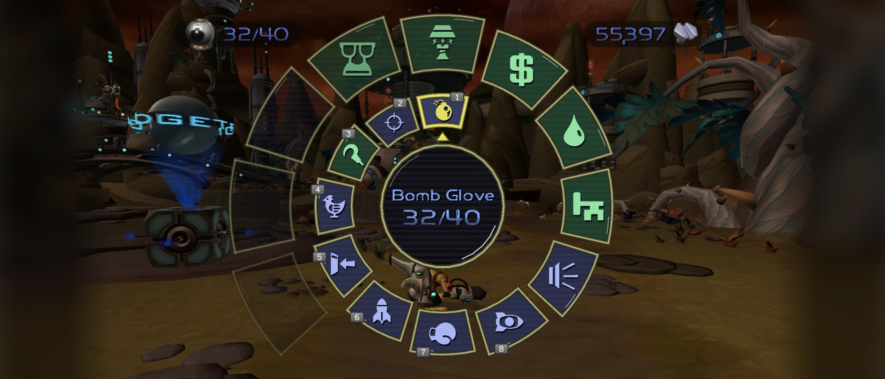
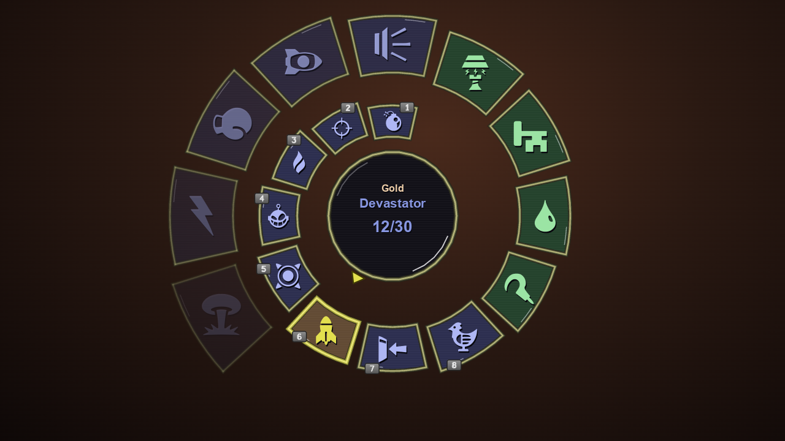
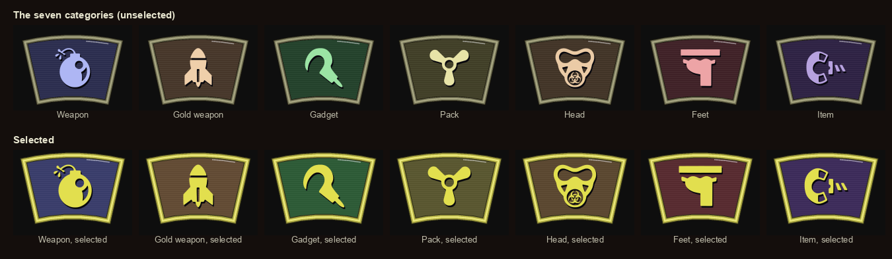

# Spiral Weapon Wheel

Prey (2017)'s spiral weapon wheel for Ratchet & Clank, drawn as the game's own menu panels.

[Watch it in game on YouTube](https://youtu.be/TsFeHlWv1F8): opening on the quick select, turning
through the loops, picking a weapon.

## What it does

Hold Triangle and the game slows down for a moment, then holds (Going Commando's own pause). Every
weapon and gadget you can put on your quick select lies on one spiral, twelve to a loop, and the
stick turns through it, loop after loop. Your own quick select comes first, in its numbers' order;
the other weapons, then the gadgets, follow.

Each slot is a Ratchet & Clank menu panel bent around the spiral, washed in its item's colour as
the game colours its icons: blue for weapons, orange-tan for a weapon whose gold version you own,
green for gadgets. Quick select items carry their number on a small badge, the pointed-at item's
name and ammo show in the round middle panel, and the health meter hides while the wheel is open.

## How to use it

- **Hold Triangle** to open the wheel.
- **Turn the stick** to move through the spiral; the first push points at the item in that
  direction on the first loop. The **d-pad** steps one item at a time.
- **Let go of Triangle** to equip the item you point at. Let go before moving the pointer and
  nothing changes.
- **Circle** closes the wheel without picking anything.
- **Double-tap Triangle** for the quick swap to your previous weapon, as before.

## Settings

| Setting | Default | Choices | What it does |
|---|---|---|---|
| Pause while open | On | On, Off | On, the world holds while the wheel is open. Off, the wheel opens over the running game. |
| Slow-down before pausing | Short | Off, Short, Prey-like | The game slows to an eighth of its speed as the wheel opens, then pauses. *Short* is about 0.15 s, *Prey-like* about 0.3 s, *Off* pauses at once. |
| Ease back on close | Off | On, Off | On, the game's speed eases back up as the wheel closes. |
| Open and close | Hold | Hold, Toggle | *Hold*: let go of Triangle to pick. *Toggle*: the wheel stays up when you let go; press Triangle again to pick. |
| Hold before pausing | A little longer | Going Commando, A little longer, Longer | How long Triangle is held before the wheel opens: Going Commando's own 4 frames, 8 (so taps and double taps don't open it), or 12. |
| Size | 1 | 0.5 to 1.5 | The wheel's size. |
| Start angle | 90 | -180 to 180 | Where the spiral starts, in degrees counter-clockwise from 3 o'clock: 90 is 12 o'clock. |
| Clockwise | Off | On, Off | Off, the spiral turns counter-clockwise (Prey Menu's way); on, clockwise. |
| Spiral motion | Continuous | Continuous, Loop steps | *Continuous*: the spiral follows the pointer. *Loop steps*: the pointer's whole loop shows, and the spiral turns to the next loop as the pointer crosses into it. |
| Spiral grows | Outward | Outward, Inward | *Outward*: your quick select's ring is innermost and the rest spiral out (the later loops may run past the screen's edge). *Inward*: the quick select's ring is outermost and the rest spiral in, kept inside the screen. |
| Spiral depth | 0.75 | 0 to 1 | How far in each slot is from the one before. |
| Click sound | Off | On, Off | A sound as the pointer moves to another item (a stand-in: Ratchet & Clank's quick select is silent). |

## Requirements

- **OpenRAC with mod interface 1.40 and three new hook points, none of them in a release yet**
  ([OpenRAC#865](https://github.com/OpenRAC/OpenRAC/pull/865),
  [OpenRAC#863](https://github.com/OpenRAC/OpenRAC/pull/863), and
  [OpenRAC#862](https://github.com/OpenRAC/OpenRAC/pull/862) so the Field of View stays as it is
  while the world holds). A game without them refuses the mod and says why.
- **Ratchet & Clank**, PAL and NTSC-U.
- No other mods needed.

## Compatibility and known issues

- **Conflicts** with Going Commando weapon wheel (`gc-weapon-wheel`), Weapon Wheel Pause
  (`weapon-wheel-pause`) and `pause-weapon-wheel`: all of them replace the quick select.
- **Gadget Quick Use** has not been tested together with this mod (it also reads Triangle).
- **Enhanced Movement:** while the world holds, the camera does not move.

## Add icons for your own mod's items

Mod authors: the wheel draws every item as a flat glyph, and any mod can add or replace them, such
as an equipment mod's new weapon. Put a `spiral-wheel-icons/` folder in your mod's folder; no
dependency on this mod is needed. See [Add your own icons](README.md#add-your-own-icons) in the
README and the full spec in [ICONS.md](ICONS.md).

## Credits

By Henning Berge.

- Spiral design from **Prey Menu** by **KerosenileArsonist**
  ([Nexus Mods](https://www.nexusmods.com/newvegas/mods/94499)).
- The glyphs are original drawings by **Henning Berge**. No game-derived art is shipped.
- The pause and the quick select's timing are **Going Commando's quick select**, from OpenRAC's
  [rac2-decomp](https://github.com/OpenRAC/rac2-decomp).

Licence: the code is GPL-3.0; the glyphs are GPL-2.0-or-later (details
in the [README](README.md#license) and [THIRD_PARTY_NOTICES.md](THIRD_PARTY_NOTICES.md)).

## Feedback

Found a bug or have an idea? Open an issue on
[GitHub](https://github.com/Promises/openrac-spiral-weapon-wheel/issues). Pull requests are welcome.

Developer documentation: [README](README.md)
