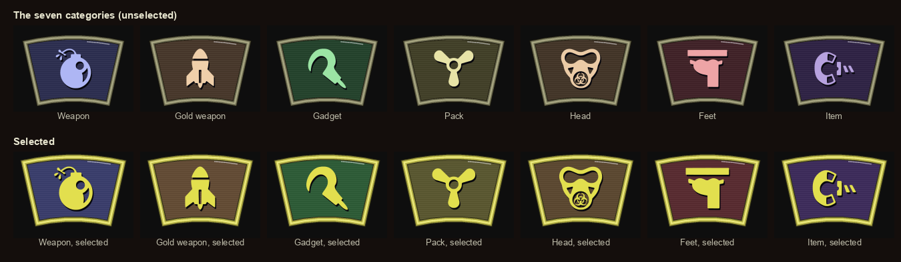

# Icons for the Spiral Weapon Wheel

The wheel draws each item as a **glyph**: a single-colour shape that the wheel colours itself, by
the item's **category**. Glyphs come in **icon packs**. The mod's own glyphs are a pack
(`assets/glyphs/rac1/`), read exactly as yours will be. That pack is the reference example.



## Where packs go

| Folder | Whose |
|---|---|
| `<plugins>/spiral-weapon-wheel/assets/glyphs/<game>/` | the mod's own (built in) |
| `<plugins>/<your mod>/spiral-wheel-icons/` | a mod's pack, e.g. an equipment mod's icon for its new weapon |
| `<plugins>/spiral-weapon-wheel/icons/` | the player's own |

`<plugins>` is OpenRAC's plugins folder (`<data>/plugins`).

The packs count in that order: the built-in pack, then other mods' packs (in the order of their
folders' names), then the player's own. **A later pack's icon for an item replaces an earlier one.**
The log names each replacement:

```
icon packs: item 0xA: Laser Pistol's icon over Spiral Weapon Wheel glyphs's
```

An item that no pack draws falls back to:

1. a glyph the mod makes from the game's own HUD icon. It reads that icon from the player's disc
   data, and the result is never shipped.
2. the game's own icon.

The folders are read when a level loads. A pack you add, change or remove counts from the next
level on.

## A pack: `icons.json` and the glyphs

```json
{
  "format": 1,
  "name": "Laser Pistol",
  "author": "A. Modder",
  "license": "CC BY 4.0",
  "icons": [
    {"game": "rac1", "item": "0x24", "glyph": "laser-pistol.svg", "category": "weapon"},
    {"game": "rac1", "item": 10, "glyph": "glyphs/bomb.png", "category": "weapon",
     "wash": "#803030", "glyph_color": "#FFD0D0", "selected_glyph_color": "#FFFFFF",
     "wrap": "Laser-|Pistol"}
  ]
}
```

Pack fields:

| Field | |
|---|---|
| `format` | `1` (required). A wheel refuses a format it does not know and logs it. |
| `name`, `author`, `license` | Shown in the log. Say what others may do with your drawings. |
| `icons` | The list. |

Fields of each icon:

| Field | |
|---|---|
| `game` | The game's id: `rac1`. An icon for another game is ignored by this one. |
| `item` | The item's id: a number (`10`), or hexadecimal as a string (`"0x0A"`, `"0a"`). |
| `glyph` | A file inside the pack's folder: `.svg` (recommended) or `.png`. |
| `category` | Optional: `weapon`, `gold`, `gadget`, `pack`, `head`, `feet` or `item`. Without it, the item's own category is used. |
| `wash`, `glyph_color`, `selected_glyph_color` | Optional `"#RRGGBB"`: your own colours over the category's (the slot's wash; the glyph; the glyph when pointed at). |
| `wrap` | Optional: where the item's name may break onto two lines in the wheel's middle, `|` marking the break. See below. |
| `special` | Instead of `item`, for something the game does not keep as an item (the built-in pack's Zoomerator, Raritanium, Codebot, Premium and Ultra Nanotech). It is kept with the pack but never shown on the wheel. |

A bad icon is left out, and the log says why. The rest of the pack still counts.

### Long names: `wrap`

The wheel's middle disc is small, and the game draws its text at one fixed size. The wheel tries to
fit the name in this order:

1. the normal font;
2. the small font;
3. a break at a space onto two lines (normal font, then small);
4. the pack's `wrap` hint onto two lines (normal font, then small);
5. the small font, cut short with "…".

The hint is for a long single word, for example `"wrap": "Hydro-|displacer"`:

- The text before the `|`, including any hyphen you write there, ends line 1.
- The hint is used only when the game's name is exactly the hint with the `|` removed and with any
  hyphen written just before it ignored. "Hydro-|displacer" matches "Hydrodisplacer", and
  "Thruster-|Pack" matches "Thruster-Pack".
- A translated or renamed item does not match. It falls back to the steps above, so a hint never
  shows a name that is not the game's.

The built-in pack has hints for Hydrodisplacer, Morph-o-Ray, Map-o-Matic and Thruster-Pack.

### Without `icons.json`

Plain files also work: `<pack>/<game>/<item>.svg` or `.png`, with `<item>` in hexadecimal. For
example, `<plugins>/spiral-weapon-wheel/icons/rac1/0a.svg` replaces the Bomb Glove. These files take
the item's own category and colours.

## Drawing a glyph

- **SVG** (recommended), as the built-in glyphs are drawn: one `<path fill="currentColor" d="..."/>`
  on `viewBox="0 0 256 256"`. The wheel draws it at 256 pixels and crops it to the shape. Only the
  shape counts; the colour comes from the wheel.
- **PNG**: white on transparent. The alpha is the shape. Any size works; 128 px or more square is
  best.

The wheel fits the glyph's larger side to the slot's glyph square (0.64 of the slot's thickness, 0.7
when pointed at). It colours the glyph and adds a dark drop shadow, so draw it flat, without your
own shadow or outline.

## Categories and colours

Each category is one of Ratchet & Clank's menu groups, coloured as the game colours its icons. The
slot is washed with the category's colour (30 %, or 45 % when pointed at), and the glyph is drawn
in its light tint. When the slot is pointed at, it gets a yellow frame and a yellow glyph.

| Category | Wash | Glyph | The game's items |
|---|---|---|---|
| `weapon` | `#6B74D0` | `#AEB6F4` | the Quick Select page's weapons |
| `gold` | `#C49257` | `#EFCFAA` | a weapon whose gold version you own (automatic) |
| `gadget` | `#4FB55C` | `#9BE4A4` | the Quick Select page's hand gadgets |
| `pack` | `#B0AC4E` | `#E7E3A7` | Heli-Pack, Thruster-Pack, Hydro-Pack |
| `head` | `#B48A4E` | `#EBCBA6` | O2 Mask, Sonic Summoner, Pilot's Helmet |
| `feet` | `#AC4C4E` | `#EDA4A6` | Magneboots, Grindboots |
| `item` | `#724DAB` | `#B7A2DF` | Hoverboard, Map-o-Matic, Bolt Grabber, Persuader, ... |

**Gold needs no entries of its own.** A `weapon` whose gold version the player owns is drawn as
`gold`. This uses the game's own flag, the one its pause menu draws the gold icon by. Write
`"category": "gold"` to make an icon always gold.

Only weapons, gold weapons and gadgets normally appear on the wheel. The other categories are there
for completeness and for mods that add items.

## An equipment mod's new item

A weapon a mod registers (`rac1_weapon_register`) takes one of the port's two extension items, 1 or
36. It appears on the wheel when the player owns it and it has an icon (the weapon's `icon`, or its
presentation weapon's). Its HUD icon is usually a retail weapon's, so to give it its own glyph:

1. Ship `spiral-wheel-icons/icons.json` in your mod's folder with an icon for your item's id (e.g.
   `"item": "0x24"` for 36) and its `glyph`.
2. Give it `"category": "weapon"`, or nothing: a registered weapon is a weapon.

That is all. No dependency on this mod is needed: without the wheel, the folder is ignored.

More equipment slots are expected as OpenRAC grows. The wheel caps nothing: any number of items, any
item id (up to `0xFFFFFFF`), as many spiral loops as it takes. An icon is looked up by whatever id
the item has.

Texture-pack authors can ship a wheel pack the same way (a `spiral-wheel-icons/` folder).
Texture-pack pictures (`<data>/texture_packs/`) are not used by the wheel. That may come later.

## What the wheel does not ship

The built-in glyphs are original drawings (see `assets/glyphs/LICENSE-glyphs`). The mod ships
nothing taken from the game. Its fallback glyphs are made from the player's own disc data while it
runs.
