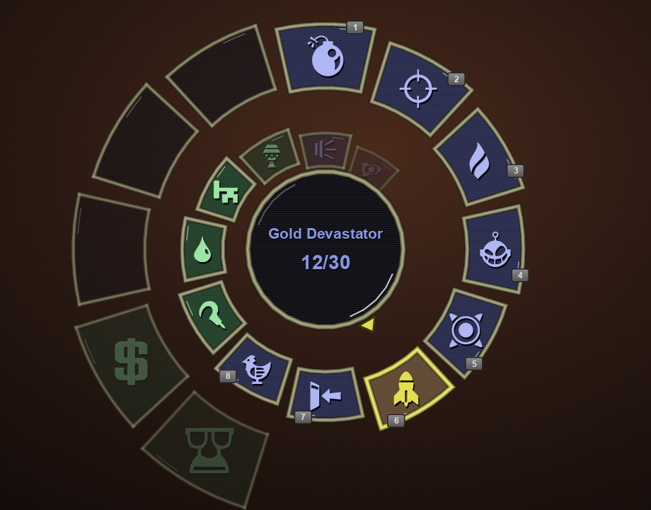

# Spiral Weapon Wheel

A native mod for [OpenRAC](https://github.com/OpenRAC/OpenRAC)'s port of Ratchet & Clank: a weapon
wheel in the style of Prey (2017)'s favourites wheel. Its spiral comes from
[Prey Menu](https://www.nexusmods.com/newvegas/mods/94499) by KerosenileArsonist, a Fallout: New
Vegas mod. Its look is Ratchet & Clank's own menu panels, bent around the spiral. The pause and the
timing come from Going Commando's own quick select, whose decompiled code it runs.

**The mod ships no game-derived art.** Its panels, badges and pointer are drawn by its own code as
it loads. Its glyphs are original drawings by Henning Berge (`assets/glyphs/`, under their own
terms: see below). An item without a drawing gets a glyph made from your own game's disc data
while the mod runs.



*A mock-up drawn by the mod's own painter (`src/spiral/paint.cpp`) with its own glyphs, through its
icon pack loader, and a stand-in font. In the game the names, numbers and font are Ratchet &
Clank's own. The Devastator here is a gold one.*

- **Hold Triangle.** The game slows down for a moment, then holds (Going Commando's pause, with no
  freeze dialog and no dimming).
- **The spiral.** Everything you can put on your quick select (the weapons and gadgets of the pause
  menu's Quick Select page) lies on a spiral, twelve to a loop. Your own quick select is the home
  ring: its eight items sit on the first loop in the directions they have on the game's ring, so
  the stick points where you know them (the first push of each opening lands on that loop); the
  others fill the free slots, then the next loops. The spiral winds inward, each slot a little
  further in than the one before. Turn the stick around and the pointer goes round and round through
  the loops; twelve slots are shown whole and the ones beyond fade out either side. With "Spiral
  motion" *Continuous* (the default) the spiral follows the pointer all the time, as Prey Menu's
  does, the pointed-at slot in the middle of the twelve; with *Loop steps* the pointer's whole loop
  is shown, and the spiral turns to the next loop as the pointer crosses into it. The d-pad steps
  one item at a time.
- **What it shows.** Every slot is a menu panel bent into its sector: scanlines, a khaki frame and
  a white glint, washed in its item's category colour, as the game colours its icons: blue for a
  weapon, orange-tan for a weapon whose gold version you own, green for a gadget (and for mods'
  items, yellow packs, peach head gear, red foot gear, purple other items). Each item's glyph is
  drawn in the category's light tint with a dark drop shadow. The pointed-at slot has the yellow
  "Load Game" frame and a yellow glyph, and is pushed out. Items on
  your quick select carry their number on a small grey badge. The pointed-at item's name and ammo
  are in the round middle panel, in the pause menu's blue. The health meter is hidden while the
  wheel is open (the bolt and ammo counters stay), and comes back as it was.
- **Picking.** Let go of Triangle to equip the pointed-at item. Let go before you have moved the
  pointer and nothing changes (so a double tap's swap stands). Circle closes the wheel without
  picking anything. There is no "None" slot.
- **Double tap Triangle** for the quick swap to your previous weapon, as before.

## Settings

| Setting | Default | What it does |
|---|---|---|
| Pause while open | on | On, the world holds while the wheel is open. Off, the wheel opens over the running game. |
| Slow-down before pausing | Short | As the wheel opens, the game's time eases down to an eighth of its speed, then the pause holds it, as Prey's wheel does. *Short* is about 0.15 s of game time, *Prey-like* about 0.3 s, *Off* pauses at once. |
| Ease back on close | off | On, the game's time eases back up as the wheel closes, the way it slowed down. |
| Open and close | Hold | *Hold*: let go of Triangle to pick. *Toggle*: the wheel stays up when you let go; press Triangle again to pick. |
| Hold before pausing | A little longer | How long Triangle is held before the wheel opens. *Going Commando* is its own 4 frames, *A little longer* 8 frames (so taps and double taps don't open it), *Longer* 12. On PAL: 3, 7, 10. |
| Size | 1 | 1 is the design's size: the first loop is about nine tenths of the screen's height across. |
| Start angle | 90 | Where the spiral starts, in degrees counter-clockwise from 3 o'clock (90 is 12 o'clock). |
| Clockwise | on | Which way the spiral turns (on is the design's; Prey Menu's default was off). |
| Spiral motion | Continuous | *Continuous*: the spiral follows the pointer at all times (Prey Menu's way), the pointed-at slot in the middle of the twelve shown whole. *Loop steps*: the pointer's loop is shown whole, and the spiral eases to the next loop as the pointer crosses into it. Changed live. |
| Spiral depth | 0.75 | How far in each slot is from the one before: the design's 11 pixels (of 720) at 0.75 and below, less above it, down to 5 at 1. |
| Click sound | off | A sound as the pointer moves to another item (Ratchet & Clank's quick select is silent; this is a stand-in). |

## Requirements

**OpenRAC with mod interface 1.40 and three hook points**, none of them in a release yet:

- the overlay pictures and the layer under the HUD:
  [OpenRAC#865](https://github.com/OpenRAC/OpenRAC/pull/865);
- the hook points `rac1.level.update_play`, `rac1.freeze.update` and `rac1.freeze.draw`:
  [OpenRAC#863](https://github.com/OpenRAC/OpenRAC/pull/863);
- and, so the Field of View stays as it is while the world holds,
  [OpenRAC#862](https://github.com/OpenRAC/OpenRAC/pull/862).

A game without them refuses the mod and says why. Until they are merged, `sdk.lock` pins the SDK of
the branch `spiral-wheel-test` of [Promises/OpenRAC](https://github.com/Promises/OpenRAC), which
merges the three.

Ratchet & Clank PAL and NTSC-U.

## Compatibility

- **Going Commando weapon wheel**, **Weapon Wheel Pause** (`weapon-wheel-pause`, `pause-weapon-wheel`):
  these conflict, because all of them replace the quick select. The manifest says so.
- **Gadget Quick Use** has not been tested together with this mod. It reads Triangle at pads,
  faucets and the Swingshot.
- **Enhanced Movement**: while the world holds, the camera does not move.

## How it works

- **The pause** is Going Commando weapon wheel's, unchanged:
  - Going Commando's quick select gate and mode 7, copied from
    [rac2-decomp](https://github.com/OpenRAC/rac2-decomp) into `src/gc/`;
  - run on Ratchet & Clank by a translation layer (`src/gc/rac1_shim.*`) in its freeze mode, through
    the three hook points;
  - with its hold before the pause, its double tap (the double tap's timers also run in the pause),
    its 50/60 Hz scaling and its watchdogs.
  - [THIRD_PARTY_NOTICES.md](THIRD_PARTY_NOTICES.md) lists every file and line copied.
- **The wheel** replaces the quick select's update and draw (`src/gc/rac1_spiral.cpp`):
  - It keeps their frame: the fades, the pick as Triangle is let go, the usage statistics, item
    0x18's rule.
  - In place of the eight-slot ring, it uses the spiral (`src/spiral/`, game-agnostic). Its pointer
    is ported from Prey Menu's menu and scripts:
    - the pointer's angle grows by the stick's turn;
    - the spiral wraps through blank slots (Prey Menu's "None" slot, before the first item, is a
      blank here);
    - each slot's angle.
  - Its look is the design's (`src/spiral/look.hpp`): a continuous spiral, the pointer's loop's
    first slot 284 pixels out (of 720), each slot after it 11 further in; a panel 0.33 of its
    radius thick across 25.2 of its 30 degrees, its glyph 0.64 of the thickness (0.7 selected); the
    4 slots before the twelve shown whole and the 3 after them at 55, 42, 30, 22 % and 50, 32,
    18 %; an empty slot among the twelve at 60 %. *Continuous*: the twelve are the pointer's 6
    before it and 5 after it, so every slot's radius and opacity follow the pointer's distance
    from it. *Loop steps*: the twelve are the pointer's loop; when the pointer moves into another
    loop, the spiral eases there (0.06 s), turning the way the pointer went.
  - The painter (`src/spiral/paint.cpp`) draws it all as quads of four pictures it makes as the
    mod loads (the scanlines, white, the badge, the pointer) and the glyphs: the panels in strips
    of a few degrees, the frame's four strokes centred on each edge, widest first.
- **The order**: the game's quick select first, each item at the first loop's slot nearest its
  direction on the game's ring (`draw_hud_item_selector_panel`: slot 0 at the top, the others
  clockwise, 45 degrees apart). The first loop is the 12 slots from the start angle on (item 0 on
  it). The cardinal directions fit the 30-degree slots exactly; a diagonal goes to the slot nearer
  the vertical (45 to 60, 135 to 120, -45 to -60, -135 to -120), so the two beside one side never
  meet. The others follow: the first loop's free slots in order, then outward. The first push of
  an opening points at the first loop's slot in the stick's direction; after it the stick turns
  the pointer as Prey Menu's does.
- **The glyphs** come from icon packs ([ICONS.md](ICONS.md) is the guide for making one). The
  mod's own glyphs are a pack (`assets/glyphs/rac1/`: 38 original SVG drawings and their
  `icons.json`), read by the same loader as any other. Packs from other mods
  (`<plugins>/<mod>/spiral-wheel-icons/`) and the player's own (`<plugins>/spiral-weapon-wheel/icons/`)
  come after it, and a later pack's icon replaces an earlier one, with a line in the log. An SVG is
  drawn at 256 pixels (nanosvg) and cropped to its shape. A PNG's alpha is the shape. The wheel
  colours each glyph by its category, the game's own grouping: the Quick Select page's weapons and
  hand gadgets; the pause menu's pack, head and foot grids; other items. A pack may name its own
  category and colours. A weapon whose gold version the player owns is gold:
  `gold_weapon_purchased`, the flag the pause menu draws the gold icon by
  (`games/rac1/decomp src/game/ui/pause.c:2977`).
- **An item no pack draws** (a weapon a mod registered, without an icon of its own) gets a glyph
  made from the item's HUD icon. The mod reads that icon itself from the player's disc data: the
  level's `data.bin` under the port's `game_data_dir`, the HUD header and its banks 0 and 1,
  decompressed by the mod's own WAD reader (`src/rac1/`). It never reads the game's copy, which is
  only there while the pause menu is open. The glyph is keyed in the icon's palette: its ground is
  saturated colour and its glyph near-neutral grey, so each palette entry's coverage follows its
  chroma, and the icon's anti-aliased edge stays. Every decode is checked before use. Without the
  disc data, the glyph comes from game memory, as 1.1.2's did, with its checks; otherwise the
  game's own icon is drawn. The log says, once a level, where each item's icon came from.
- **The items** are those of the pause menu's Quick Select page: the owned items of its weapons
  grid (15 cells), then of its hand gadgets grid (6 cells), read from the game's own tables
  (`pause_item_candidate_entries`, `pause_hand_gadget_cells`), shown and assigned when owned as the
  page does (`draw_menu_item_grid`, `update_menu_item_slots`). Nothing of the Items page. After
  them comes a weapon an equipment mod registered: the port's two extension items, 1 and 36, when
  owned and with an icon in their definition (`item_defs` +0x38, which the port sets), as the
  port's own quick select lists them. Each item's HUD icon is its definition's.
- **The pictures** (the panels and the glyphs) are drawn under the game's HUD by the mod's overlay
  (interface 1.40). The text, and any icon drawn as the game's sprite, are drawn on top, through
  the game's own HUD calls: the quick select numbers in its small font, the name in its normal
  one and the ammo in its large one, the name and ammo over a dark copy a unit down and right (as
  the game shadows its own text).
- **The health meter** (its HUD record: slot 1, id 0x7535) is closed on every tick the wheel shows,
  from its first: Ratchet & Clank's own Triangle shows it on each press (`hero_update_transitions`).
  When the wheel closes, whichever way, it is shown again as that press shows it, for
  `scale_ticks(0xB4)` (3 seconds). Going Commando's pause also shows it; the mod leaves that out.
- **The slow-down** uses the port's slow motion (`time_stretch`). The game's time scale goes down
  evenly from 1 to an eighth over the setting's length, then Going Commando's pause begins.

### Where each behaviour comes from

| Behaviour | From |
|---|---|
| The spiral: 12 a loop, the pointer turning with the stick, the wrap, the settings | Prey Menu's scripts and menu |
| The look: menu panels on a continuous spiral, the washes, frames, glints, badges, the pointer, the middle panel, the fades either side | the user's design, after Ratchet & Clank's menus |
| What the Quick Select page can assign, like Prey's favourites | the mod's own choice; the rule is the game's |
| The quick select as the home ring, the diagonals' rounding, the first push on that loop | the mod's own choice |
| The glyphs: original drawings, in an icon pack any mod can add to | the user's drawings and choice |
| The categories' colours | the game's own icon grounds (sampled by the user); weapon and gadget the design's |
| Glyphs for items without a drawing, from the player's own disc data, keyed in the palette | the mod's own, from the HUD format (OpenRAC, after ReRAC) and the decompilation |
| The health meter hidden while open | Prey hides its HUD; the mod's own way |
| Nothing picked until the pointer moved | Going Commando (its quick select opens on nothing) |
| The quick select's items marked with their number, as Prey Menu marks hotkeys | the mod's own choice |
| The slow-down, then the pause | Prey's wheel as seen in its footage; the ramp is the mod's own (Prey's time scaler eases to a target over a duration) |
| The pause, the hold before it, the double tap, the fades, the pick on release | Going Commando, from its decompilation |
| The stick's rest (0.5) and the wait for it before the stick picks | Going Commando |
| The d-pad stepping one slot, Circle cancelling, the toggle mode's second press | the mod's own choice |
| No background blur | not done (no blur in the port's API) |

## The log

The game's log (`openrac-rac1-*.log`, lines `[mod spiral-weapon-wheel]`) shows:

- at load and in each level, whether the hook points, the quick select's functions and the
  pictures were found;
- one line per Triangle press, giving why the wheel did not open or the trace of the hold;
- in each level, where its HUD set came from (the disc data, or not), the icon packs read (their
  name, author, licence and icons), each icon a later pack takes over, a pack's problems, and,
  once, where each item's icon came from;
- at each opening, the items on the spiral in order; the stick's first turns (as read, its
  direction, the slot); and the pick ("picked item 0x.. (name), equipped 0x..") or "cancelled";
- one line per double-tap swap;
- a warning if the pause ever had to be ended by its watchdog.

## Build

```sh
python3 tools/fetch_sdk.py          # the SDK sdk.lock pins, into .sdk/
cmake -S . -B build -G Ninja
cmake --build build && ctest --test-dir build
python3 .sdk/openrac-mod-sdk-*/tools/package_mod.py build/package/spiral_weapon_wheel
```

The tests:

- `src/spiral_test.cpp` checks the spiral against Prey Menu's own formulas, written out as its XML
  evaluates them, over millions of pointer angles. It covers both directions, start angles, depths
  and item counts, plus the stick and the opening. It checks the look against the design's values:
  each slot's radius, opacity, push, glyph and badge places, the fades either side, both spiral
  motions (following the pointer with no snap at a loop's end; the turn to another loop both ways;
  switched while open), the depth's step; and the painter's quads (the washes, the
  yellow frame, the glyphs' colours, sizes and shadows, the badges, the pointer) and its pictures.
- `src/spiral_weapon_wheel_test.cpp` runs the layer, the copied code and the wheel on a fake game:
  - the items offered (none of the Items page), the selection through the loops, the d-pad and the picks (an item, item 0x18,
    a blank, the item in hand, Circle, a release before moving);
  - the icons' sources: the built-in pack, a mod's pack and the player's file over it, a pack's
    category and colours, a gold weapon, an equipment mod's item 36 from the disc data (a synthetic
    data file), the packs read again only at a level's load;
  - the glyphs from game memory when there is no disc data (synthetic icons only: no game pixels in
    the tests): their capture with the pages made stale after it (kept) and before it (rejected
    with the reason, the game's sprite), the pause menu's capture and a level change; the health
    meter hidden and restored on every way out;
  - the toggle mode and the draw (the slots' glyphs, the badges' numbers in the small font, the
    name and ammo in the normal and large fonts over their shadow, in the menu's blue);
  - the slow-down into the pause and the ease back;
  - the pause from the hold to the release, the gate's conditions, taps, double taps and holds at
    each "Hold before pausing", 50/60 Hz, and the watchdogs.
- `src/icons_test.cpp`: the WAD reader, a level's HUD set from a synthetic data file, the JSON
  reader, icon packs (ICONS.md's example, bad entries, plain files, the order they count in, the
  pictures kept until a file changes), and the mod's own pack through the same loader: all 38
  drawings drawn, each at its category.

## Credits

- **Prey Menu** by **KerosenileArsonist** (<https://www.nexusmods.com/newvegas/mods/94499>): the
  spiral's design, used with credit as its Nexus permissions ask. (Up to 1.1.2 the wheel also used
  its art; since 1.2.0 the mod ships none.)
- **Going Commando's code**: [rac2-decomp](https://github.com/OpenRAC/rac2-decomp) (Kryštof
  "Lynder063" Malinda and its contributors; earlier llesieur99).
- **Ratchet & Clank's**: [OpenRAC](https://github.com/OpenRAC/OpenRAC)'s decompilations and the
  OpenRAC mod SDK.
- **The glyphs**: original drawings by **Henning Berge**.
- **nanosvg** by Mikko Mononen (zlib licence): draws the SVG glyphs. **stb_image** by Sean Barrett
  (public domain or MIT): reads PNG glyphs.
- **The HUD and WAD formats**: OpenRAC's readers, after [ReRAC](https://github.com/re-rac/rerac)
  (ISC).
- Prey's wheel was studied through [Chairloader](https://github.com/thelivingdiamond/Chairloader)'s
  headers. Nothing of Prey's is copied.

## License

- **The code** is under the GNU General Public License version 3 ([LICENSE](LICENSE)). The files
  copied from rac2-decomp, and `src/gc/rac1_spiral.cpp`, are GPL-3.0-only. The mod's own files are
  GPL-3.0-or-later.
- **The glyphs** (`assets/glyphs/`) are original drawings by Henning Berge, **not** under the GPL.
  The licence they are offered under is to be decided (`assets/glyphs/LICENSE-glyphs`). Nothing in
  the mod is taken from the game: no game-derived art is shipped. `docs/mockup.png` and
  `docs/categories.png` are drawn by the mod's own code with these glyphs.
- [THIRD_PARTY_NOTICES.md](THIRD_PARTY_NOTICES.md) has the details. The package carries it as
  `LICENSE.THIRD_PARTY_NOTICES.md`.

Ratchet & Clank and Ratchet & Clank: Going Commando are trademarks of Sony Interactive
Entertainment, developed by Insomniac Games. Prey is a trademark of ZeniMax Media. This mod is not
affiliated with or endorsed by any of them, and contains none of their code or assets.
